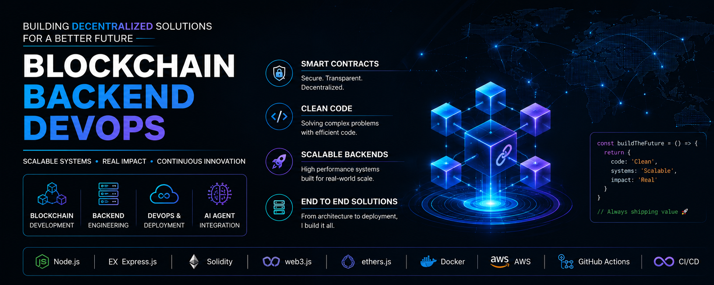
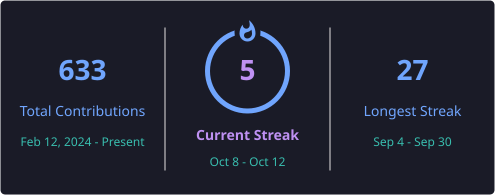
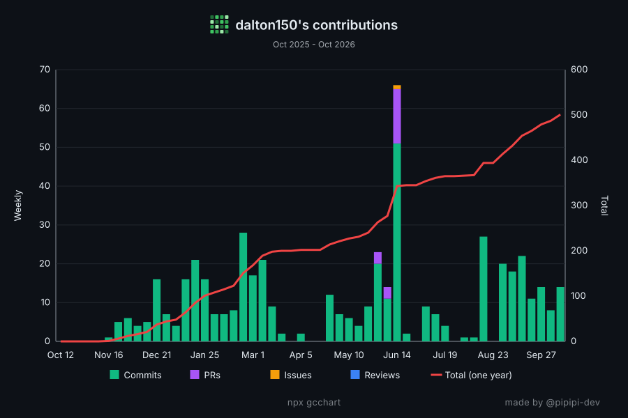

 

# Shivam Singh &nbsp;·&nbsp; `dalton150`

**Backend & Blockchain Engineer &nbsp;|&nbsp; DevOps &nbsp;|&nbsp; AI Systems**

*I build production-grade backend, blockchain, DevOps, and AI systems for scalable Web2 & Web3 applications.*

 

&nbsp;

&nbsp;

 

---

## Proof of Work

| | |
|:---:|:---|
| **3+ Years** | Production engineering across Web2, Web3, and backend systems |
| **100+** | Trading pairs on a live multi-chain DEX with bridging protocols |
| **100+** | Production smart contracts deployed across EVM-compatible networks |
| **50+** | Reward and referral distribution systems shipped to production |
| **5+** | Complex binary-tree referral and reward distribution projects |
| **Full-Stack** | Cloud infrastructure, CI/CD pipelines, and end-to-end production deployments |

---

## Work Tracks

<table>
<tr>
<td valign="top" width="25%">

### Backend
**Production**

- Node.js · Express.js · JavaScript · TypeScript
- MongoDB · PostgreSQL · Redis · RabbitMQ
- REST APIs · WebSockets
- Real-time & distributed systems

</td>
<td valign="top" width="25%">

### Blockchain
**Production**

- Solidity · Smart Contracts
- Ethers.js · Web3.js · Web3 APIs
- EVM chains · Real-time txs
- Hardhat · Foundry · IPFS
- ERC20 · ERC721 · ERC1155
- ERC4626 · ERC2612 · EIPs

</td>
<td valign="top" width="25%">

### DevOps & Cloud
**Production**

- Linux · Docker · Kubernetes
- GitHub Actions · Jenkins
- CI/CD pipelines
- AWS · Nginx · Deployments

</td>
<td valign="top" width="25%">

### AI & Agentic
**Learning / Exploring**

- AI agent integration
- RAG · ChromaDB
- OpenAI APIs
- Open-source models & frameworks
- Progress: tool calling done
- Next: full agent workflows

</td>
</tr>
</table>

---

## Featured Systems

### AMR — Staking and Reward Platform

**September 2026**

| | |
|:--|:--|
| **Problem** | Run staking, deposits, and payouts without duplicate or inconsistent settlements |
| **Built** | Hybrid Web2 ledger with on-chain settlement, wallet authentication, and blockchain event indexing |
| **Stack** | `Node.js` · `Smart Contracts` · `Docker` · `Nginx` · `HTTPS` |
| **Impact** | Production staking platform with idempotent deposit and payout processing |

Deterministic financial workflows use integer base units, fixed allocation rules, earning caps, and fail-closed pricing. Role-based authorization spans the backend and smart contracts, with admin and operator controls plus two-step ownership for privileged actions. Production runs behind Docker, an Nginx reverse proxy, HTTPS, isolated environments, and operator automation for deploy, verify, and admin workflows.

---

### ORNOXX — Jewellery E-commerce and Commission Backend

**May 2026 – July 2026**

| | |
|:--|:--|
| **Problem** | Run jewellery commerce, live gold pricing, payments, and multi-level commissions in one backend |
| **Built** | Node.js and Express platform for catalog, cart, orders, coupons, reviews, admin, and member workflows |
| **Stack** | `Node.js` · `Express.js` · `Redis` · `Razorpay` · `JWT` |
| **Impact** | Production commerce backend with verified payments, dynamic pricing, and monthly commission settlement |

Pricing is calculated from gold rates, product weight, making charges, and GST, with Redis caching. Razorpay payments are verified on the server. JWT covers multi-role authentication. Commission flows cover genealogy, business volume, level income, wallets, withdrawals, and monthly settlement. Franchise fulfillment is inventory-aware across stores and a central warehouse.

---

### Binary Trading Platform

**January 2026 – March 2026**

| | |
|:--|:--|
| **Problem** | Process timed crypto trades, multi-chain deposits, and rewards without manual balance updates |
| **Built** | Real-time trading backend for multiple crypto pairs, with trade windows from 30 seconds to 24 hours |
| **Stack** | `Node.js` · `HD Wallets` · `Multi-chain` · `WebSockets` |
| **Impact** | Automated deposits, trade resolution, and reward distribution across community trading flows |

HD-wallet infrastructure issues unique multi-chain deposit addresses and listens for blockchain transactions. Event-driven workers update balances, process deposits, and distribute rewards. The trade lifecycle covers order placement, time-based resolution, and result processing.

---

### RevoX.exchange

**January 2025 – March 2025**

| | |
|:--|:--|
| **Problem** | Move and swap assets across chains without a single-network exchange |
| **Built** | Multi-chain DEX with cross-chain communication, token swaps, and 100+ trading pairs |
| **Stack** | `Node.js` · `Ethers.js` · `Solidity` · `WebSockets` |
| **Impact** | Live cross-chain swaps, bridging, and real-time transaction tracking |

Bridging protocols and cross-chain workflows move assets between networks. Node.js and Ethers.js services handle smart-contract calls and transaction processing. Liquidity pools and swap execution run the trading path, with WebSocket tracking for live trades and chain activity.

---

### Token & Presale Ecosystem

| | |
|:--|:--|
| **Problem** | Take a token from creation through staking, vesting, presale, and distribution without separate one-off contracts |
| **Built** | Production token infrastructure for ERC20, ERC721, and ERC1155, including staking, vesting, presale, and mining |
| **Stack** | `Solidity` · `Hardhat` · `Foundry` · `Ethers.js` · `Node.js` · `MongoDB` · `IPFS` |
| **Impact** | 50+ reward distribution systems across multiple tokenomics models |

Contracts follow EVM standards and EIP patterns so issuance, lockups, staking, and presale settlement stay consistent across networks.

---

### AI Chat Backend (RAG)

| | |
|:--|:--|
| **Problem** | Build a context-aware AI backend that retrieves accurate answers from large document sets |
| **Built** | Applied RAG backend with vector search, embedding pipelines, and LLM integration |
| **Stack** | `Node.js` · `OpenAI API` · `ChromaDB` · `RAG` |
| **Impact** | Working RAG retrieval pipeline with context-grounded responses |

Document chunking, embedding generation, vector similarity search, and grounded response generation.  
**Note:** Full Agentic AI (multi-agent orchestration beyond tool calling) is tracked separately under Learning.

---

## Tech Stack Map

**Backend**

**Databases & Cache**

**Blockchain**

**EVM Standards**

**DevOps & Cloud**

**AI & Agentic (Learning)**

---

## GitHub Stats

> **Note:** The widgets below reflect **personal repositories only** (public and private repos you own). They refresh **every 15 minutes** and when you push changes to `README.md`. Do not edit `profile/*.svg` manually.

 

 

---

## Currently Exploring

- **Agentic AI** — tool calling completed; building toward multi-agent orchestration and full agent workflows
- Advanced RAG — hybrid search, re-ranking, memory layers, and ChromaDB pipelines
- Open-source models and frameworks for agent integration

---

## Connect

📍 Gurugram, India

 

&nbsp;

&nbsp;

---

*"Great systems are built through simplicity, reliability, and continuous improvement."*

